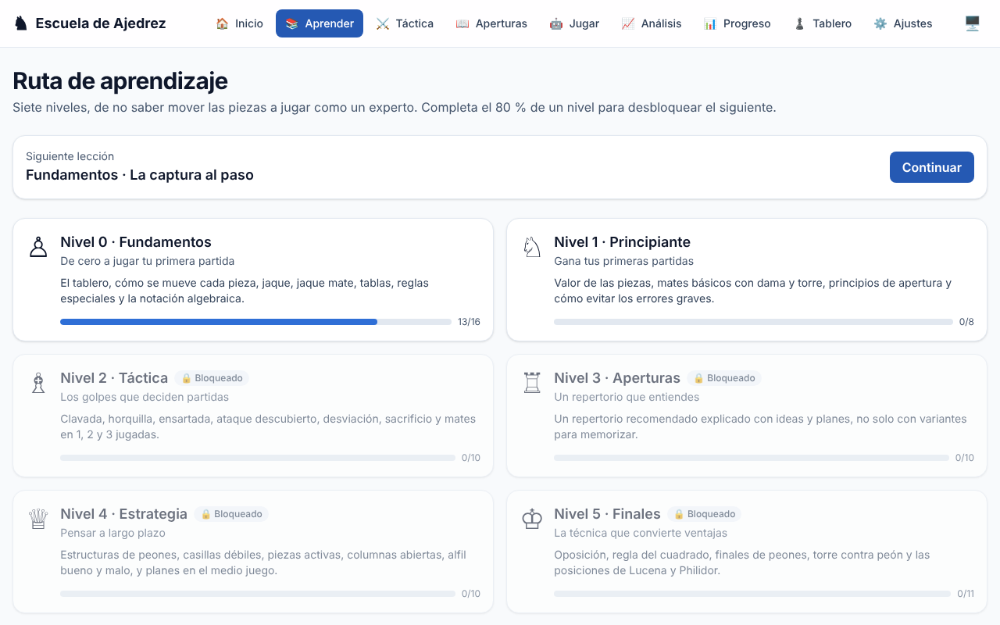
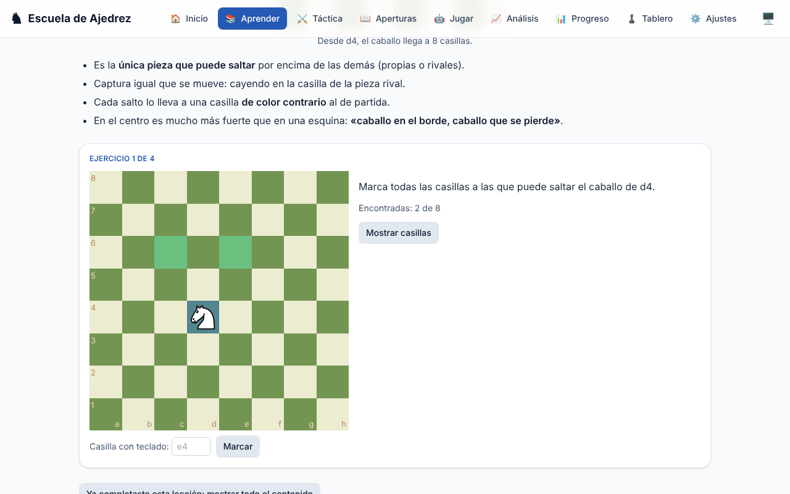
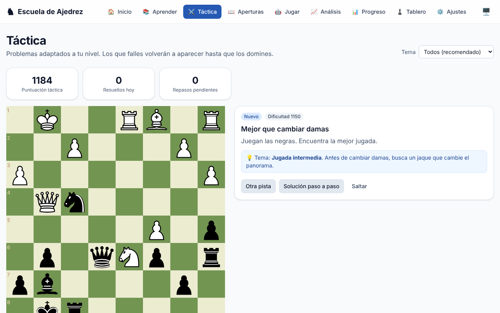
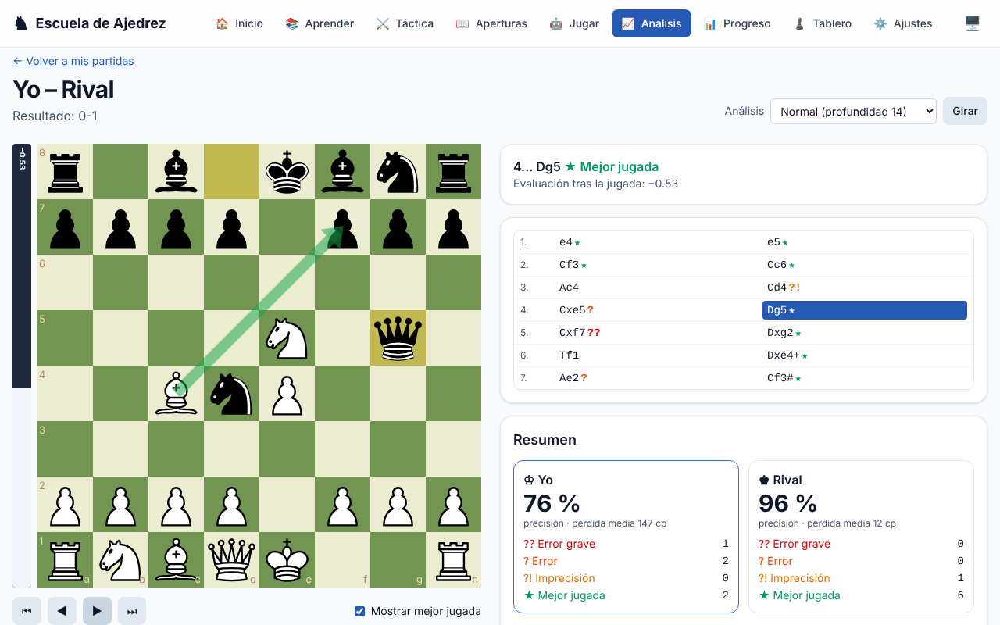
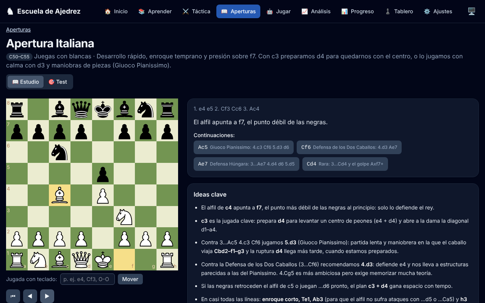

# ♞ Escuela de Ajedrez

Aplicación web para **aprender ajedrez desde cero hasta nivel experto**: una ruta de aprendizaje por niveles con lecciones interactivas, entrenamiento táctico con repetición espaciada, entrenador de aperturas, partidas contra Stockfish con análisis y seguimiento del progreso. Funciona sin registro ni servidor: todo se guarda en el navegador.

**👉 Pruébala en <https://fmic23.github.io/ChessLearning/>**



## Funcionalidades

| | |
|---|---|
| 📚 **Ruta de aprendizaje** | 7 niveles desbloqueables (Fundamentos, Principiante, Táctica, Aperturas, Estrategia, Finales y Avanzado) con lecciones cortas: teoría, diagramas y ejercicios interactivos (jugar jugadas, marcar casillas, test y práctica contra el ordenador). |
| ⚔️ **Táctica** | Banco de problemas con dificultad progresiva adaptada a tu puntuación, pistas en dos niveles, solución paso a paso y explicación del motivo táctico. **Repetición espaciada** (SM-2): los problemas fallados vuelven a aparecer con más frecuencia. Importación de la base abierta de Lichess. |
| 🧠 **Anticipación** | **Visualización**: calcula sin mover las piezas (se muestran las jugadas solo escritas y hay que encontrar el golpe final). **¿Qué amenaza el rival?**: ponte en su lugar y descubre su golpe. |
| 🤖 **Jugar contra el ordenador** | Stockfish 18 (WebAssembly, en un Web Worker) con 8 niveles, de ~400 a ~2500 Elo. Deshacer, pistas, botón **«¿Qué amenaza?»** (muestra lo que quiere hacer el rival) y modo **«Adivina la jugada del ordenador»** con estadística de aciertos. |
| 📈 **Análisis de partidas** | Precisión, imprecisiones, errores y errores graves (umbrales de Lichess), mejor jugada con variante, gráfica de evaluación interactiva y momentos clave. Importa tus partidas en PGN. |
| 📖 **Entrenador de aperturas** | Repertorio completo explicado con ideas. **Modo estudio** (árbol de variantes comentado) y **modo test** (la app juega el rival y te pregunta tus jugadas). |
| 📊 **Progreso** | Elo estimado (problemas + partidas), racha de días, calendario de actividad, evolución de la puntuación, **puntos débiles detectados** con enlaces para practicarlos y exportación/importación del progreso en JSON. |

Al seleccionar o arrastrar una pieza, sus casillas posibles se sombrean en **gris** y las capturas en **rojo**; tocando una pieza rival se ve también su alcance.

Además: interfaz en español de España, diseño adaptable a móvil y escritorio, **modo oscuro**, navegación por teclado (jugadas escritas en notación española o inglesa, flechas para recorrer partidas) y buen contraste.

<p align="center">
  
  
</p>
<p align="center">
  
  
</p>

## Instalación y uso

Requisitos: **Node.js 20 o superior** (recomendado 22).

```bash
git clone https://github.com/FMIC23/ChessLearning.git
cd ChessLearning
npm install
npm run dev          # http://localhost:5173
```

| Comando | Descripción |
|---|---|
| `npm run dev` | Servidor de desarrollo |
| `npm run build` | Build de producción en `dist/` |
| `npm run preview` | Sirve el build de producción |
| `npm test` | Tests unitarios y de componentes (Vitest + Testing Library) |
| `npm run lint` / `npm run typecheck` | ESLint y comprobación de tipos |
| `npm run validate:content` | Valida todo el contenido (estructura, FEN, legalidad de las soluciones) |
| `npm run validate:content -- --engine` | Además, verifica con Stockfish que cada solución es la mejor jugada |
| `npm run puzzles:import -- --input <csv>` | Importa problemas de la base de Lichess |

## Arquitectura

```
├── content/                 # Contenido didáctico (sin código)
│   ├── lessons/<nivel>/     #   level.json + lecciones .md con bloques ```tablero y ```ejercicio
│   ├── puzzles/*.json       #   banco de problemas tácticos
│   └── openings/*.json      #   repertorio de aperturas por líneas
├── scripts/                 # Validación de contenido, importación de Lichess, copia de Stockfish
├── src/
│   ├── app/                 # Enrutado (HashRouter), layout, navegación, tema
│   ├── components/          # Tablero, lista de jugadas, barra y gráfica de evaluación, UI
│   ├── content/             # Carga del contenido con import.meta.glob
│   ├── engine/              # Cliente UCI de Stockfish (Web Worker), niveles de dificultad
│   ├── features/            # Páginas: lessons, tactics, openings, play, analysis, progress...
│   ├── lib/                 # Lógica pura y testeada: reglas, lecciones, SRS, Elo, análisis,
│   │                        #   aperturas, puntos débiles, PGN, copia de seguridad
│   ├── store/               # Estado global con Zustand persistido en localStorage
│   └── types/
└── .github/workflows/       # CI (lint, tipos, contenido, tests, build) y despliegue en Pages
```

**Decisiones principales**

- **React 19 + TypeScript estricto + Vite**, **Tailwind CSS 4** (modo oscuro por clase) y **react-chessboard** para el tablero.
- **chess.js** valida reglas y jugadas; el tablero admite arrastrar, clic-clic y teclado.
- **Stockfish 18 lite (un hilo)** compilado a WebAssembly, ejecutado en un **Web Worker**. Se usa la versión de un solo hilo porque GitHub Pages no permite las cabeceras COOP/COEP necesarias para la multihilo. El cliente (`src/engine/StockfishEngine.ts`) encola peticiones y permite cancelarlas. Los niveles bajos piden varias candidatas (MultiPV) y eligen con aleatoriedad controlada para simular errores humanos; los altos usan `UCI_Elo`.
- **Análisis**: la evaluación se convierte en probabilidad de ganar y cada jugada se clasifica por la pérdida de probabilidad (5/10/15 puntos: imprecisión/error/error grave), con la precisión de Lichess.
- **Repetición espaciada** (`src/lib/srs.ts`): variante de SM-2. Un fallo reinicia la tarjeta (vuelve a los 10 minutos), baja su facilidad y frena el crecimiento posterior del intervalo.
- **Elo** (`src/lib/elo.ts`): fórmula Elo con factor K decreciente. El «Elo estimado» combina la puntuación de problemas y la de partidas (las partidas pesan más con el tiempo).
- **Persistencia**: Zustand + `localStorage`, sin backend. El progreso se puede exportar e importar en JSON.
- **Enrutado con `HashRouter`** y `base: './'`: la app funciona en cualquier subruta (GitHub Pages) sin configuración de servidor. Las páginas se cargan bajo demanda.

## Cómo añadir lecciones

Las lecciones son archivos Markdown en `content/lessons/<nivel>/`, con un frontmatter sencillo, diagramas y ejercicios en JSON:

````markdown
---
title: La clavada
summary: Una pieza no puede moverse sin exponer otra más valiosa.
tags: tactica, clavada
---

Teoría en **Markdown**...

```tablero
{ "fen": "4k3/8/8/8/8/8/8/4K3 w - - 0 1", "arrows": [["b5", "e8"]], "caption": "La clavada" }
```

```ejercicio
{ "type": "moves", "fen": "6k1/5ppp/8/8/8/8/5PPP/R5K1 w - - 0 1", "solution": ["a1a8"], "goal": "mate", "prompt": "Da mate en una jugada." }
```
````

Después, ejecuta `npm run validate:content -- --engine` para comprobar que todo es legal y que las soluciones son correctas. La guía completa de formatos (lecciones, ejercicios, problemas y aperturas) está en **[docs/CONTENIDO.md](docs/CONTENIDO.md)**.

## Problemas de Lichess

El banco propio está en `content/puzzles/`. Para ampliarlo con la [base de problemas de Lichess](https://database.lichess.org/#puzzles) (CC0):

```bash
zstd -d lichess_db_puzzle.csv.zst
npm run puzzles:import -- --input lichess_db_puzzle.csv --count 2000 --min 600 --max 2400
```

El script hace una selección equilibrada por dificultad y tema y la guarda en `content/puzzles/lichess.json`.

## Despliegue

Cada push a `main` ejecuta `.github/workflows/deploy.yml`, que pasa los tests, construye la app y la publica en GitHub Pages. Requisito (una sola vez): en **Settings → Pages → Build and deployment → Source**, elige **GitHub Actions**.

## Licencia

Código bajo licencia **MIT** (véase [LICENSE](LICENSE)). El motor [Stockfish](https://stockfishchess.org/) ([stockfish.js](https://github.com/nmrugg/stockfish.js)) se distribuye como programa independiente bajo **GPLv3**. Las piezas del tablero provienen de react-chessboard.
